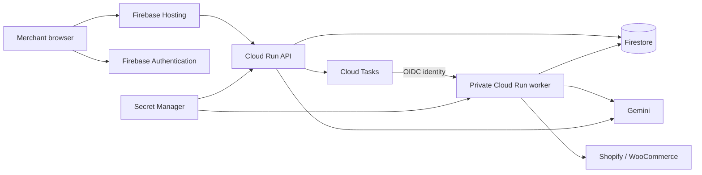

# Deploy ReturnRadar on Google Cloud

The deployment uses Firebase Hosting for the React frontend, two Cloud Run services for the API and background worker, Firestore for persistent merchant data, Firebase Authentication for Google sign-in, Cloud Tasks for analysis and store imports, Secret Manager for secrets, Artifact Registry for the container, Cloud Build for validation/builds, and Cloud Logging for operational logs.

Firestore is the database. Firebase Hosting serves the website and forwards `/api/**` to Cloud Run on the same origin. The configured region is Mumbai (`asia-south1`). Firebase Hosting supports this Cloud Run region. [Firebase documentation](https://firebase.google.com/docs/hosting/cloud-run)



All commands below are manual. Nothing pushes to GitHub, creates a GitHub build trigger, or deploys simply because a commit is pushed. Review the files, push your chosen commit yourself, and then run the deployment commands from that reviewed checkout.

## 1. Create the project and Firebase sign-in

Use one Google Cloud project with billing enabled, and add Firebase to that same project in the [Firebase console](https://console.firebase.google.com/). Cloud Run and this Hosting integration require a billing-enabled project; choose the Firebase Blaze plan. [Firebase documentation](https://firebase.google.com/docs/hosting/cloud-run)

Install Google Cloud CLI, Firebase CLI 15.33 or later, Node.js 22, and Python 3.11. Cloud Shell has Google Cloud CLI; install the Firebase CLI there if needed. A local Docker installation is optional because Cloud Build builds the container remotely.

```bash
gcloud auth login
firebase login
cp infra/deploy.env.example infra/deploy.env
```

Fill in `PROJECT_ID`, `FIREBASE_WEB_API_KEY`, and `FIREBASE_SUPPORT_EMAIL` in `infra/deploy.env`. The support email must be authorized to manage the project's OAuth brand and appears as public support contact information. Use plain `KEY=value` entries without quotes, inline comments, or shell expressions. Other values can keep their defaults. `infra/deploy.env` is ignored by Git, Cloud Build uploads, and Docker. The Firebase web API key identifies the Firebase app and is public configuration; the Gemini API key stays in Secret Manager. [Firebase API-key documentation](https://firebase.google.com/docs/projects/api-keys)

If using Google Cloud Application Default Credentials (ADC) instead of a separate `firebase login`, sign into the deployment account and set the quota project explicitly:

```bash
gcloud auth login --update-adc
gcloud config set project YOUR_GOOGLE_CLOUD_PROJECT_ID
gcloud auth application-default set-quota-project YOUR_GOOGLE_CLOUD_PROJECT_ID
gcloud auth list --filter=status:ACTIVE --format='value(account)'
```

Confirm the active account has access to the selected project. Firebase CLI uses an existing Firebase login before ADC, so keep both sign-ins on the deployment account or use ADC without a separate Firebase CLI login. The `auth` and `hosting` commands scope `GOOGLE_CLOUD_QUOTA_PROJECT` to `PROJECT_ID` for Firebase requests; an ADC quota setting alone is insufficient with some Firebase CLI versions. They also clear the shell's `DEBUG` setting for that process to avoid verbose request output. [ADC guidance](https://cloud.google.com/docs/authentication/set-up-adc-local-dev-environment)

If adding Firebase from the CLI rather than the console, use the same explicit quota project:

```bash
GOOGLE_CLOUD_QUOTA_PROJECT=YOUR_GOOGLE_CLOUD_PROJECT_ID DEBUG= firebase projects:addfirebase YOUR_GOOGLE_CLOUD_PROJECT_ID
```

In the Firebase console:

1. Register a Web app under Project settings → General and copy its API key into the deployment configuration.
2. Use `bash scripts/deploy-cloud.sh auth` below to enable **Google**. If the CLI version or organization policy prevents this, open Authentication → Get started → Sign-in method and enable Google with the configured support email in the console.
3. Under Authentication → Settings → Authorized domains, add `PROJECT_ID.web.app` and `PROJECT_ID.firebaseapp.com`. If you use a custom Hosting domain, authorize it too.
4. In the Google Cloud OAuth web client configuration for this Firebase app, include `https://PROJECT_ID.web.app/__/auth/handler` as an authorized redirect URI. For a custom domain, add its matching `/__/auth/handler` URI as well.

The auth helper generates ignored `infra/generated/firebase-auth.json` with only `auth.providers.googleSignIn`, including ReturnRadar's display name, support email, and additional redirect URIs for `PROJECT_ID.web.app` and any custom `FIREBASE_AUTH_DOMAIN`. Firebase provisioning adds the standard `PROJECT_ID.firebaseapp.com/__/auth/handler` callback automatically; the helper omits it to avoid a duplicate redirect error. It deploys only `auth`; it does not enable anonymous or email/password sign-in or alter their existing settings. The CLI selects the project's default/first web app, so this flow is intended for the dedicated project with one ReturnRadar web app. For a project with several web apps, configure the intended app in the console. [Firebase auth CLI documentation](https://firebase.google.com/docs/auth/configure-providers-cli)

The default `FIREBASE_AUTH_DOMAIN` is `PROJECT_ID.web.app`. Firebase Hosting serves the reserved `/__/auth/*` endpoints ahead of the SPA rewrite, allowing Google sign-in on the hosted domain. Keep the authorized domain, OAuth redirect URI, and configured auth domain in agreement. [Firebase auth-domain guidance](https://firebase.google.com/docs/auth/web/redirect-best-practices)

The person running bootstrap needs permission to enable APIs, create service accounts/resources, and change IAM policies. Subsequent builds need Cloud Build permission, access to upload into the source staging bucket, and permission to act as `returnradar-build`. Deployments need Cloud Run deployment/IAM permission and permission to act as the API/worker identities. The scripts do not grant Owner or Editor to runtime service accounts.

## 2. Validate the reviewed checkout

```bash
bash scripts/deploy-cloud.sh check
python3 -m venv .venv
.venv/bin/python -m pip install -r requirements-dev.txt
DEMO_MODE=false AUTH_PROVIDER=local STORAGE_BACKEND=sqlite DATABASE_PATH=/tmp/returnradar-tests.db .venv/bin/python -m pytest -q
npm ci
VITE_API_URL='' npm run build
```

The `check` command is local and does not contact Google Cloud. It checks the Hosting rewrite, denied browser database access, pinned dependencies, container configuration, ignore files, and any tracked local credential/database files. It never reads `.env` or `data/connector.key`. Runtime dependency versions are pinned in `requirements.lock`; `requirements-dev.txt` adds test dependencies. Node dependency versions are pinned in `package-lock.json`. Cloud Build repeats backend checks and the frontend build on Linux before creating the container.

Before you push, review `git status` and the changes. Keep `.env`, `data/`, generated configuration, tokens, and service-account JSON files out of the repository. No service-account key download is required: Cloud Run uses its attached service identities.

## 3. Prepare resources and secrets

These commands create or update Google Cloud resources and IAM bindings in the project you selected:

```bash
bash scripts/deploy-cloud.sh bootstrap
bash scripts/deploy-cloud.sh secrets
```

Bootstrap creates the container repository, a default Firestore database if needed, a bounded task queue, the source staging bucket, four dedicated service accounts, and two Secret Manager secrets. It enables Firestore deletion protection and point-in-time recovery on the default database. This is intended for a dedicated ReturnRadar project; if the project already contains another application, review these changes first. Firestore location is chosen at database creation and cannot be changed by editing the deployment configuration later. [Firestore database documentation](https://cloud.google.com/firestore/docs/manage-databases), [Firestore recovery documentation](https://cloud.google.com/firestore/docs/pitr)

The secrets command asks for the Gemini key using hidden terminal input and generates a fresh Fernet encryption key for store connections. It skips secrets that already have an enabled version and never prints their values. Deployments pin the selected enabled version number rather than `latest`.

**Preserve the connector encryption key.** Existing encrypted credentials need the same key to be decrypted. A fresh cloud deployment starts with an empty Firestore database; local SQLite data, local passwords, test accounts, and local connector credentials are not uploaded. Recreate the cloud merchant workspace and reconnect the stores. A data migration should be planned separately with the matching encryption key; changing the key alone does not migrate data. [Secret Manager deployment guidance](https://cloud.google.com/run/docs/configuring/services/secrets)

Runtime permissions are intentionally separated:

| Identity | Access |
| --- | --- |
| `returnradar-api` | Firestore data, Firebase user lookup for token revocation checks, enqueue to this task queue, use the task dispatch identity, read the two app secrets |
| `returnradar-worker` | Firestore data and the two app secrets |
| `returnradar-tasks` | Invoke only the worker Cloud Run service |
| `returnradar-build` | Write to this Artifact Registry repository, read this staging bucket, write build logs |
| Cloud Tasks service agent | Sign tokens for the task dispatch identity |

Cloud Tasks sends an OIDC token to the private worker; the API identity is allowed to act as only the dedicated dispatch account. Firebase Hosting calls the API through public Cloud Run invocation, while the application checks verified Firebase identity and workspace permissions for merchant data. Browser Firestore access remains denied by `firestore.rules`. [Cloud Tasks authentication](https://cloud.google.com/tasks/docs/creating-http-target-tasks#http_target_tasks_with_authentication_tokens), [queue-level permissions](https://cloud.google.com/tasks/docs/secure-queue-configuration)

## 4. Build, review, and deploy

```bash
bash scripts/deploy-cloud.sh build
bash scripts/deploy-cloud.sh deploy
bash scripts/deploy-cloud.sh auth
bash scripts/deploy-cloud.sh hosting
bash scripts/deploy-cloud.sh verify
```

The build validates the code, creates one API/worker container, and saves its immutable image digest to ignored `infra/generated/image.txt`. Cloud Build uses a dedicated account and stores logs in Cloud Logging. It does not deploy anything. Review the build before running `deploy`. [Cloud Build service-account documentation](https://cloud.google.com/build/docs/securing-builds/configure-user-specified-service-accounts)

Deploy creates the private worker first, grants invocation to the task account, and configures the API to enqueue to the worker. Both roles use Firestore, Google sign-in, disabled shared demo mode, the reviewed model, and injected secrets. Neither uses SQLite or a local encryption-key file in the cloud. The container runs without root and listens on Cloud Run's `PORT`.

After `auth`, verify that both standard Hosting domains are authorized in Firebase Authentication settings; add any custom auth domain there. Hosting rebuilds the frontend with `VITE_API_URL=''`, overriding any developer `.env` URL so requests stay on the hosted origin. It deploys Firebase Hosting and the Firestore rules using the explicit project ID and quota project. Generated Firebase configurations use the same configured API service and region in their Hosting rewrite. `/api/**` is rewritten before the SPA fallback. The API rewrite pins the deployed API revision so the frontend release and its API revision move together. [Firebase revision pinning](https://firebase.google.com/docs/hosting/cloud-run)

Your site will be **`https://PROJECT_ID.web.app`**. The default hosted sign-in is Google; the local test account and password do not exist in Firebase.

For a custom domain, attach it through Firebase Hosting, set `FIREBASE_AUTH_DOMAIN` and `CORS_ORIGINS` in the deployment configuration, authorize its Firebase domain, then rerun `deploy`, `auth`, and `hosting`.

## 5. Validate the hosted merchant workflow

The `verify` command checks website/health routes, cloud sign-in configuration, rejection of unauthenticated merchant requests, and the worker's IAM protection. It does not run Gemini or import store data.

Manually test once on the hosted site:

1. Sign in with a fresh Google account and choose **Explore demo**. Verify a private sample workspace appears with 18 products across nine categories, 256 returns, draft improvements and three planned product reviews. The sample banner must stay visible; initial fixtures do not represent a completed Gemini analysis or measured return reduction.
2. Follow the demo links through Patterns, Action Center, Product Reviews and Ask Radar. Run analysis and wait for completion. In Settings, choose **Start my workspace**; this opens a separate empty workspace for store connections or CSV imports. Returning to the demo must preserve saved decisions. A second account choosing the same workspace name must get a separate workspace; a foreign workspace ID must be denied. Existing merchant data must be unaffected.
3. Confirm Action Center source filters, all patterns, review-cycle results, concise Ask Radar responses, and approved buyer previews.
4. Invite a second Google account, accept the link, and check its assigned role and workspace boundary.
5. Connect Shopify or WooCommerce with that merchant's credentials, sync data, and verify counts before analysing it. Tokens entered here are encrypted in Firestore with the stable Secret Manager key.
6. Refresh, sign out/in, and confirm persisted data. Buyer guidance on actual store product pages is labelled **Coming soon**; this release publishes ReturnRadar previews only.

Hosting has a 60-second proxy limit. Analysis and connector imports run through Cloud Tasks, allowing the API to return immediately while the browser polls their status. The private worker has a 30-minute request deadline; its task lease expires after that deadline, and retries wait five minutes. Ask Radar uses a short synchronous model-call budget. [Hosting timeout](https://firebase.google.com/docs/hosting/cloud-run), [Cloud Run tasks](https://cloud.google.com/run/docs/triggering/using-tasks)

## Operate and update

API and worker maximum instances are each capped at one for this pilot; the worker also has concurrency one and the queue dispatches one task at a time. Both services may scale to zero. These settings limit simultaneous requests, but they are not a spending cap. Set a project budget alert, monitor Gemini quotas, and review Cloud Tasks failures in the console before adding merchants. Point-in-time recovery is enabled; create and rehearse a database restore before relying on this service for business-critical data.

Use Cloud Logging to inspect Cloud Run errors and Cloud Build output. Do not add logging of connector requests, authorization headers, customer free text, secret values, or invitation links. Log access should be restricted to your operators.

After any approved code update, rerun `check`, `build`, `deploy`, `hosting`, and `verify` from the same checkout. To redeploy a previously reviewed container, put its immutable digest in `IMAGE` in `infra/deploy.env`, rerun `deploy`, and deploy the matching frontend checkout. Hosting release rollback pins its API revision; it does **not** roll back the worker or Firestore data. Keep API/worker schema changes backward compatible and roll back the worker separately if needed.

Keep the encryption secret across releases. If rotating the Gemini key, add a new Secret Manager version without exposing it in command arguments, then rerun `deploy` to pin that version. Do not rotate the connector encryption key until existing credentials are re-encrypted or reconnected.
